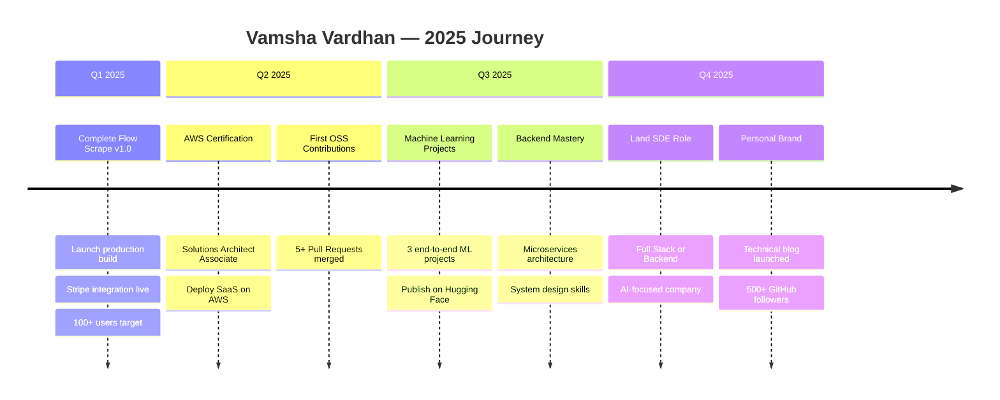

<!-- ```markdown -->
<!-- ============================================================ -->
<!--           ANIMATED HEADER - VAMSHA VARDHAN                   -->
<!-- ============================================================ -->

<div align="center">


</div>

<!-- TYPING ANIMATION -->
<div align="center">
  
</div>

<br/>

<!-- BADGES ROW -->
<div align="center">

[](https://github.com/Vamshavardhan50)
[](https://github.com/Vamshavardhan50)
[](https://github.com/Vamshavardhan50)
[](https://www.linkedin.com/in/vamshavardhan50)

</div>

<br/>

<!-- DIVIDER -->


---

<!-- ============================================================ -->
<!--                    ABOUT ME SECTION                          -->
<!-- ============================================================ -->

##  &nbsp; `whoami`

<div align="center">
  
</div>

```bash
┌──(vamsha㉿universe)-[~/about-me]
└─$ cat profile.json
```

```json
{
  "name": "Vamsha Vardhan",
  "role": "Full Stack Developer & AI Explorer",
  "university": "Computer Science Student",
  "location": "India 🇮🇳",
  "focus": ["Backend Systems", "AI/ML", "Cloud Architecture"],
  "currentBuild": "Flow Scrape — AI Web Scraper Platform",
  "learning": ["AWS Solutions Architect", "Deep Learning", "Microservices"],
  "goal2025": "Land SDE Role + AWS Certified + 10+ OSS PRs",
  "funFact": "I debug with console.log and I'm not ashamed 😄",
  "available": true,
  "coffee": "SELECT * FROM coffee WHERE consumed = TRUE; -- ∞ rows"
}
```

<br/>

<!-- ANIMATED SKILL BARS / INFO GRID -->
<table align="center">
<tr>
<td>

**🎯 Current Focus**

```
AI Web Scraping Platform   ████████░░  80%
AWS Cloud Architecture     ██████░░░░  60%
Machine Learning           █████░░░░░  50%
Open Source Contributions  ███░░░░░░░  30%
```

</td>
<td>

**⚡ Quick Stats**

```
🔥 Coding Since    →  2023
📦 Projects Built  →  10+
💾 GitHub Repos    →  20+
☕ Coffee Cups/Day →  ∞
🌟 Favourite Lang  →  Java & JS
🎯 Next Milestone  →  AWS Cert
```

</td>
</tr>
</table>

---


<!-- ============================================================ -->
<!--                    TECH STACK SECTION                        -->
<!-- ============================================================ -->

## ⚡ `TECH STACK`

<div align="center">

### 🖥️ Languages


### 🌐 Frontend Development


### ⚙️ Backend Development


### 🗄️ Databases & Storage


### ☁️ Cloud & DevOps


### 🛠️ Tools & IDE


</div>

---


<!-- ============================================================ -->
<!--                    BUILD PRINCIPLES                         -->
<!-- ============================================================ -->

## :: BUILD PRINCIPLES

<table align="center">
<tr>
<td width="33%" valign="top">

<strong>Reliability First</strong>

<pre>
- Defensive inputs
- Clear fallbacks
- Observable logs
</pre>

</td>
<td width="33%" valign="top">

<strong>Scale With Calm</strong>

<pre>
- Stateless services
- Cache before compute
- Async for heavy work
</pre>

</td>
<td width="33%" valign="top">

<strong>Clarity Wins</strong>

<pre>
- Name things well
- Small, testable units
- Predictable flows
</pre>

</td>
</tr>
</table>

---


<!-- ============================================================ -->
<!--                    NOW / NEXT / LATER                        -->
<!-- ============================================================ -->

## :: NOW / NEXT / LATER

<table align="center">
<tr>
<td width="33%" valign="top">

<strong>NOW</strong>

<pre>
- Flow Scrape v1.0 hardening
- AWS practice labs
- LeetCode consistency
</pre>

</td>
<td width="33%" valign="top">

<strong>NEXT</strong>

<pre>
- Multi-tenant scaling
- Observability dashboards
- OSS pull requests
</pre>

</td>
<td width="33%" valign="top">

<strong>LATER</strong>

<pre>
- Microservices migration
- Deep learning projects
- System design content
</pre>

</td>
</tr>
</table>

---


<!-- ============================================================ -->
<!--                    SYSTEM DESIGN CANVAS                      -->
<!-- ============================================================ -->

## :: SYSTEM DESIGN CANVAS

```text
[Client] -> [Edge] -> [API] -> [Workers] -> [Data] -> [Signals]
```

**Design checks:**

- Latency budget is explicit
- Failure paths are mapped
- Data ownership is clear
- Cost grows predictably
- Metrics are actionable

---


<!-- ============================================================ -->
<!--                  FEATURED PROJECTS                           -->
<!-- ============================================================ -->

## 🚀 `FEATURED PROJECTS`

<div align="center">

<!-- PROJECT 1 -->
<a href="https://github.com/Vamshavardhan50">

</a>

</div>

<br/>

<table align="center">

<!-- ROW 1 -->
<tr>

<td width="50%">

### 🤖 Flow Scrape — AI Web Scraper

> **Production-grade AI-powered web scraping automation platform**

```
🔧 Stack:  Next.js 14 | Puppeteer | PostgreSQL
           Prisma ORM | Clerk Auth | Stripe
⚡ Status: Active Development
🌐 Deploy: Vercel + AWS
```

**Key Features:**

- 🧠 AI-driven element detection
- 🔄 Scheduled workflow automation
- 💳 Subscription billing with Stripe
- 📊 Real-time execution analytics
- 🔐 Secure multi-tenant architecture

[](https://github.com/Vamshavardhan50)
[](https://github.com/Vamshavardhan50)

</td>

<td width="50%">

### 📚 Online Book Store

> **Full-stack e-commerce with enterprise-grade auth**

```
🔧 Stack:  React | Node.js | Express
           MongoDB | JWT | Zod Validation
⚡ Status: Completed ✅
🌐 Deploy: Render
```

**Key Features:**

- 🔐 JWT access + refresh token flow
- ✅ Zod schema validation
- 📦 Full CRUD with pagination
- 🛒 Cart & order management
- 📱 Responsive UI design

[](https://github.com/Vamshavardhan50)
[](https://github.com/Vamshavardhan50)

</td>

</tr>

<!-- ROW 2 -->
<tr>

<td width="50%">

### ☁️ Cloud Storage Platform

> **AWS-powered secure file management system**

```
🔧 Stack:  Node.js | AWS S3 | Express
           PostgreSQL | Multer | JWT
⚡ Status: Completed ✅
🌐 Deploy: AWS EC2
```

**Key Features:**

- 🔒 Secure pre-signed S3 URLs
- 📁 Folder hierarchy management
- 🔗 Shareable file links
- 📊 Storage usage analytics
- 🔐 Role-based access control

[](https://github.com/Vamshavardhan50)

</td>

<td width="50%">

### 🧠 ML/AI Projects _(Coming 2025)_

> **Deep learning experiments & implementations**

```
🔧 Stack:  Python | TensorFlow | PyTorch
           Scikit-learn | Pandas | NumPy
⚡ Status: In Planning 🔄
🌐 Deploy: Hugging Face Spaces
```

**Planned Projects:**

- 🎯 NLP Text Classifier
- 🖼️ Image Recognition CNN
- 📈 Stock Price Predictor
- 🤖 LLM Fine-tuning experiment

[](https://github.com/Vamshavardhan50)

</td>

</tr>

</table>

---


<!-- ============================================================ -->
<!--                  GITHUB ANALYTICS                            -->
<!-- ============================================================ -->

## 📊 `GITHUB ANALYTICS`

<div align="center">


</div>

<div align="center">


</div>

<br/>

<div align="center">
  
</div>

---


<!-- ============================================================ -->
<!--                     2025 ROADMAP                             -->
<!-- ============================================================ -->

## 🗺️ `2025 ROADMAP`

<div align="center">



</div>

---


<!-- ============================================================ -->
<!--                   ACHIEVEMENTS                               -->
<!-- ============================================================ -->

## 🏆 `ACHIEVEMENTS & MILESTONES`

<div align="center">

<table>
<tr>
<td align="center">


</td>
<td align="center">


</td>
<td align="center">


</td>
</tr>
<tr>
<td align="center">


</td>
<td align="center">


</td>
<td align="center">


</td>
</tr>
</table>

</div>

<br/>

<!-- TROPHY SHOWCASE -->
<div align="center">
  
</div>

---


<!-- ============================================================ -->
<!--                   CURRENTLY LEARNING                         -->
<!-- ============================================================ -->

## 📖 `CURRENTLY EXPLORING`

<div align="center">

<table>
<tr>
<td align="center" width="25%">


<br/><strong>AWS Architecture</strong>
<br/><sub>Solutions Architect</sub>

</td>
<td align="center" width="25%">


<br/><strong>Docker & K8s</strong>
<br/><sub>Container Orchestration</sub>

</td>
<td align="center" width="25%">


<br/><strong>Deep Learning</strong>
<br/><sub>PyTorch & TensorFlow</sub>

</td>
<td align="center" width="25%">


<br/><strong>System Design</strong>
<br/><sub>Scalable Architecture</sub>

</td>
</tr>
</table>

</div>

---


<!-- ============================================================ -->
<!--                  CONNECT WITH ME                             -->
<!-- ============================================================ -->

## 📡 `CONNECT WITH ME`

<div align="center">

<a href="https://github.com/Vamshavardhan50">
  
</a>
&nbsp;
<a href="https://www.linkedin.com/in/vamshavardhan50">
  
</a>
&nbsp;
<a href="https://www.instagram.com/vardhan_vamsha/">
  
</a>
&nbsp;
<a href="mailto:your.email@gmail.com">
  
</a>

</div>

<br/>

<!-- CONTRIBUTION SNAKE -->
<div align="center">

> 💡 **"The best code is the code that solves real problems for real people."**
>
> 🤝 Open to **collaborations**, **internships**, and **freelance projects**
>
> 📧 Always happy to discuss **tech, AI, cloud architecture** or just **say hi!**

</div>

---

<!-- FOOTER -->
<div align="center">


</div>

<div align="center">

```
╔══════════════════════════════════════════════════════╗
║     THANKS FOR VISITING MY DIGITAL SPACE! 🚀         ║
║     Let's build something amazing together! ⚡        ║
║          — VAMSHA VARDHAN © 2025 —                   ║
╚══════════════════════════════════════════════════════╝
```


</div>
