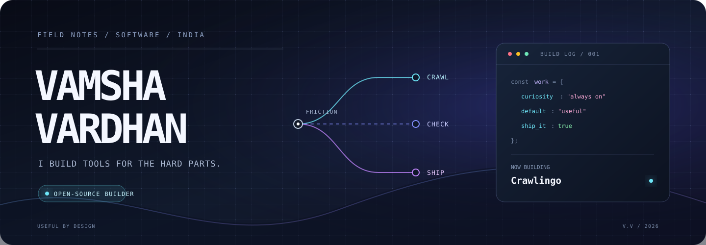

<!-- Vamsha Vardhan | profile README -->

<div align="center">



<br />

<h2>SOFTWARE, WITH THE ROUGH EDGES FIXED.</h2>

<p><b>Developer · Open-source builder · Systems thinker</b></p>

<p>
  <a href="https://github.com/Vamshavardhan50">GitHub</a> &nbsp;·&nbsp;
  <a href="https://www.linkedin.com/in/vamshavardhan50">LinkedIn</a> &nbsp;·&nbsp;
  <a href="https://www.npmjs.com/~vamsha50">npm</a> &nbsp;·&nbsp;
  <a href="https://devpost.com/chintha-vamshavardhan50">Devpost</a>
</p>

</div>

<hr />

## 001 / A note from the builder

A lot of my projects start with the same thought: **“Why is this still this annoying?”**

I’m Vamsha, a developer from India. I like building products, but I’m especially drawn to the machinery underneath them: the data pipeline that feeds an AI feature, the config check that catches a bad deploy, the tiny workflow that saves someone from doing the same chore again.

I started with full-stack apps and kept following the problems underneath. That path has led me through browser automation, developer tools, and now Rust-powered web data infrastructure.

The projects may look different, but the instinct is the same: **find the friction, understand the failure, and make the reliable path feel simple.**

> I want to be known for tools people keep using after the novelty wears off.

## 002 / The through line

<table align="center" width="100%">
  <tr>
    <td width="33%" valign="top">
      <h3>01 — NOTICE</h3>
      <p>Find the small recurring frustrations that waste time or make software fragile.</p>
    </td>
    <td width="33%" valign="top">
      <h3>02 — UNDERSTAND</h3>
      <p>Trace the real problem, including the edge cases that a clean demo can hide.</p>
    </td>
    <td width="33%" valign="top">
      <h3>03 — MAKE</h3>
      <p>Build a tool with good defaults, clear feedback, and a path for other people to use it.</p>
    </td>
  </tr>
</table>

<p align="center"><code>curiosity → systems → useful software → ship → learn → repeat</code></p>

## 003 / Selected builds

### [Crawlingo](https://github.com/Vamshavardhan50/crawlingo)

**The big one I’m building now.** Crawlingo is a Rust-powered web crawling and dataset engine for developers who need structured data from the web without assembling a new scraping stack for every project.

Pages change. Selectors break. Raw results are awkward to use. Crawlingo brings resilience, performance, and a multi-language developer experience into one tool.

| Under the hood | Why it matters |
|---|---|
| Rust async core | Efficient crawling as the workload grows |
| Selector matching with saved DOM fingerprints | A better chance of recovering when a page shifts |
| Python, Node.js/TypeScript, and Rust SDKs | Use the same engine from different stacks |
| JSON, CSV, and Parquet output | Put the data straight into the next step |
| Sessions, rate limits, monitoring, and change notifications | Move from one-off scripts toward dependable workflows |

**What I’m learning:** infrastructure needs more than speed. Good defaults, readable documentation, actionable errors, and a setup that doesn’t fight the developer are part of the engineering.

<p>
  <a href="https://github.com/Vamshavardhan50/crawlingo">↗ Source</a> &nbsp;·&nbsp;
  <a href="https://crawlingo-docs.vercel.app/">↗ Docs</a> &nbsp;·&nbsp;
  <a href="https://www.npmjs.com/package/crawlingo">↗ npm</a>
</p>

```rust
// Pull a clean field out of a noisy page.
let result = Dataset::new("https://example.com", session)
    .with_field(DatasetField::new("title", "h1"))
    .build_async()
    .await?;
```

### [envguard](https://github.com/Vamshavardhan50/envguard)

**Configuration checks that look at the code, not just a template.** `envguard` scans a project for environment variables the code actually references, then reports missing or unused keys. It runs offline, can validate rules such as URLs and ports, and avoids printing secret values.

I built it around a boring but costly failure: the app works locally, then a missing or misconfigured variable breaks production.

<p><a href="https://github.com/Vamshavardhan50/envguard">↗ Source</a> &nbsp;·&nbsp; <a href="https://www.npmjs.com/package/envguard-bin">↗ npm</a></p>

### [getgrabkit](https://github.com/Vamshavardhan50/getgrabkit)

**A small tool for a very familiar chore.** A terminal UI to select files from a GitHub repository and download just the useful subset. Sometimes you need three files, not another full checkout and a manual cleanup.

<p><a href="https://github.com/Vamshavardhan50/getgrabkit">↗ Source</a> &nbsp;·&nbsp; <a href="https://www.npmjs.com/package/getgrabkit">↗ npm</a></p>

### [ScrapeFlow](https://github.com/Vamshavardhan50/ScrapeFlow)

**A full-stack product build for visual browser automation.** It combines a node-based workflow canvas, browser actions, AI-assisted extraction, scheduling, and run history.

ScrapeFlow pushed me to think about the whole experience: show what happened, protect credentials, make the workflow understandable, and give people a way to recover when a run fails.

<p><a href="https://github.com/Vamshavardhan50/ScrapeFlow">↗ Source</a></p>

## 004 / What I care about

<table align="center" width="100%">
  <tr>
    <td width="50%" valign="top">
      <h3>MAKE IT USEFUL</h3>
      <p>Start with a real problem. Let the feature list come after.</p>
    </td>
    <td width="50%" valign="top">
      <h3>MAKE IT HARDER TO BREAK</h3>
      <p>Think through missing inputs, changing pages, bad config, slow services, and confusing errors.</p>
    </td>
  </tr>
  <tr>
    <td width="50%" valign="top">
      <h3>MAKE IT CLEAR</h3>
      <p>Names, examples, docs, and safe defaults are part of the product.</p>
    </td>
    <td width="50%" valign="top">
      <h3>SHIP, THEN LISTEN</h3>
      <p>Real use reveals the rough edges that never show up in a local demo.</p>
    </td>
  </tr>
</table>

## 005 / Inventory

These are tools I’ve used across projects; the work matters more than collecting logos.

| Area | Tools |
|---|---|
| Systems and languages | `Rust` · `Go` · `Python` · `TypeScript` · `Java` |
| Product and backend | `Next.js` · `React` · `Node.js` · `PostgreSQL` · `MongoDB` · `Redis` |
| Build and ship | `Docker` · `AWS` · `Linux` · `GitHub Actions` |

## 006 / Field notes

<div align="center">

| **6×** | **400+** | **3** |
|:---:|:---:|:---:|
| Hackathon wins | DSA problems solved | npm packages published |

</div>

Hackathons taught me to turn an idea into a working system under pressure. Problem solving taught me to stay with a hard concept or bug. Publishing packages is teaching me that “works on my machine” is the beginning: someone else needs to install it, understand it, and get value from it.

## 007 / Current experiment

I’m putting most of my builder energy into **Crawlingo**: making the core more useful, improving the SDK experience, and learning what it takes for an open-source project to become dependable infrastructure.

I’m interested in where **web data, automation, and AI systems** meet. The quality of an AI product depends on the information and systems behind it; that foundation is where I want to keep building.

## 008 / Open channel

I’m open to thoughtful collaboration around open source, developer tools, backend systems, web data, and AI infrastructure. Found a rough edge in one of my projects? Tell me. Have an idea worth building? Tell me that too.

<div align="center">

<a href="https://github.com/Vamshavardhan50">GitHub</a> &nbsp;·&nbsp;
<a href="https://www.linkedin.com/in/vamshavardhan50">LinkedIn</a> &nbsp;·&nbsp;
<a href="https://www.npmjs.com/~vamsha50">npm packages</a>

<br /><br />

<b>Build useful things. Make them dependable. Let people decide if they’re good.</b>

</div>
